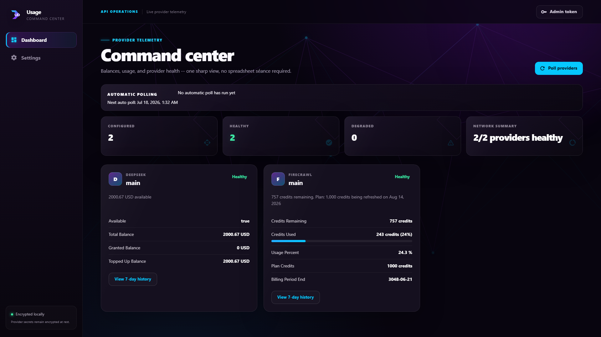

<p align="center"></p>

# Usage Dashboard

[](https://github.com/Skulldorom/usage-dashboard/releases)
[](https://github.com/Skulldorom/usage-dashboard/actions/workflows/docker-images.yml?query=branch%3Amain)
[](https://github.com/Skulldorom/usage-dashboard/pkgs/container/usage-dashboard-backend)
[](LICENSE)

Self-hosted provider usage dashboard for Firecrawl, DeepSeek, OpenAI, Anthropic/Claude, OpenRouter, OpenAI Codex, OpenCode Go, MiniMax Token Plan, and custom HTTP endpoints. It tracks current quota and health, retains history, analyzes cost and value, attributes Hermes-observed workload by provider/model/profile, stores provider credentials encrypted at rest, and exposes integrations for Homepage Dashboard and the browser extension.

<p align="center">
  <a href="https://ko-fi.com/skulldorom"></a>
</p>



## Documentation

Full documentation lives in the [documentation site](https://skulldorom.github.io/usage-dashboard/docs/). Start with [Installation options](https://skulldorom.github.io/usage-dashboard/docs/getting-started/installation.html) to compare Docker Compose, native Linux, and standalone containers.

## Quick start

Start from a machine with Git and Docker Compose installed. This path uses the published containers, so you do not need to build anything locally.

```bash
git clone https://github.com/Skulldorom/usage-dashboard.git
cd usage-dashboard
cp .env.example .env
openssl rand -base64 32 | tr '+/' '-_'
```

Copy the generated value into `ENCRYPTION_KEY` in `.env`, replacing `replace-with-generated-fernet-key`. Compose defaults to the recommended stable `latest` channel (`stable` is equivalent); set `IMAGE_TAG` to an exact published `vX.Y.Z` to pin a release. Images are not pulled or deployed automatically. Then start the stack:

```bash
docker compose pull
docker compose up -d
docker compose logs backend
```

Open the frontend, then use the one-time setup code from the backend logs to create the admin password.

- Frontend: http://localhost:3000
- Backend health: http://localhost:3000/health

See the complete [Docker Compose guide](https://skulldorom.github.io/usage-dashboard/docs/getting-started/docker-compose.html) and [First-run setup](https://skulldorom.github.io/usage-dashboard/docs/getting-started/first-run.html). Native Linux and standalone-container production deployments are documented under [Installation options](https://skulldorom.github.io/usage-dashboard/docs/getting-started/installation.html).

## Features

- 🔐 Provider credentials encrypted at rest with Fernet.
- 📊 Current quota, balance, usage history, forecasts, and provider health for eight provider types.
- 💵 PAYG and subscription cost accounting with explicit provenance and pricing coverage.
- 🧭 Hermes workload attribution by provider, model, profile, request, and session.
- 🏠 Homepage Dashboard widget with dynamic per-provider rows.
- 🧩 Chrome/Brave browser extension with one-click setup.
- 🔔 Alert thresholds and automatic background polling.

## Stack

- Backend: FastAPI, SQLAlchemy async, asyncpg, Alembic, cryptography/Fernet
- Frontend: Vite, React, MUI, React Router
- Runtime: PostgreSQL, Uvicorn, production Vite assets, nginx, and optional Docker Compose

## Development

Local source setup is a development workflow, not a production installation. See [Local development](https://skulldorom.github.io/usage-dashboard/docs/development/local-development.html) for the Vite dev server and test commands.

## License

[Mozilla Public License 2.0](LICENSE)

## Application releases

PRs targeting `main` default to `release:patch`. Maintainers select `release:minor`,
`release:major`, or `release:none` instead; ambiguous classifications block merging.
Merges automatically evaluate eligible runtime changes for a stable release after
all tests, both Docker image publications, and registry verification pass. Docs-only
and test-only changes do not create releases. Monday and manual runs remain fallbacks.
See [release policy, bootstrap, and recovery](docs/getting-started/updating.md#application-versioning-policy).
